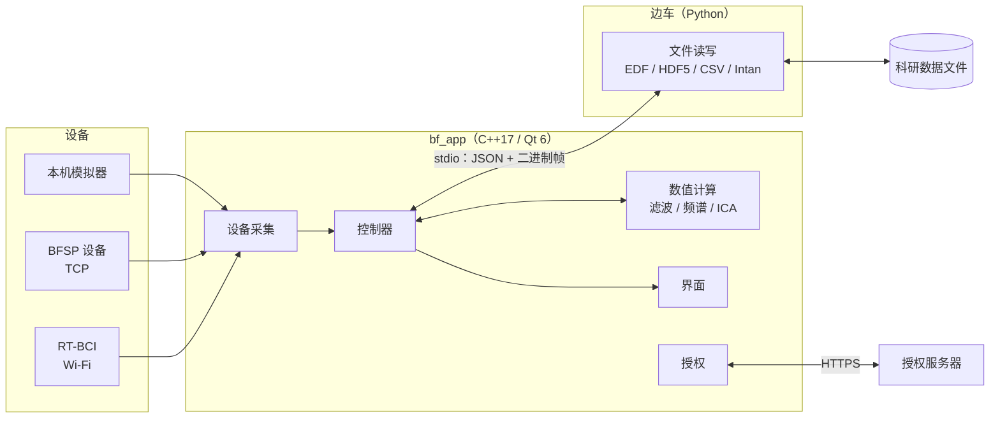
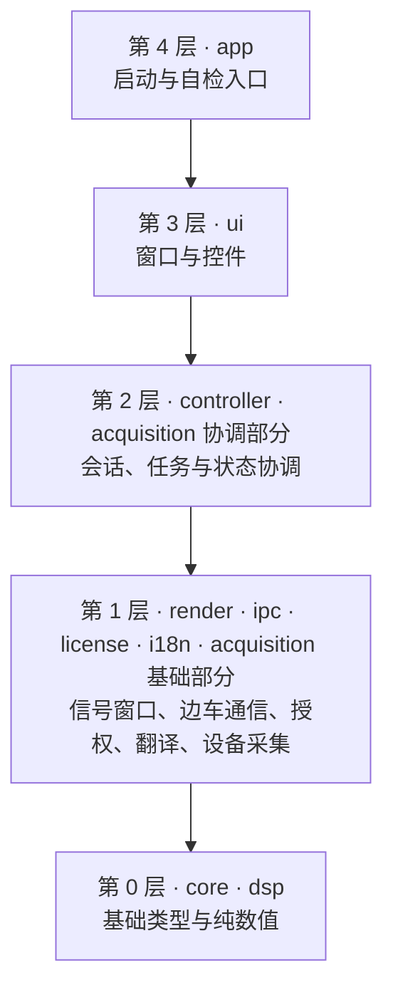
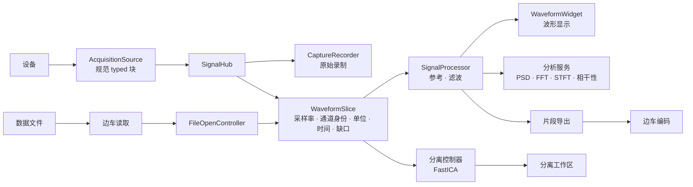

# 软件架构

本文回答三个问题：程序由哪些部分组成、代码放在哪里、数据怎么流动。前半部分是结构总览，后半部分是各条链路必须遵守的行为约束。协议与格式细节见 [基础契约](contracts.md)，产品范围见 [路线](roadmap.md)。

## 一图看懂

BoundFree EEG 是一个桌面程序加一个辅助进程：

- **主程序 `bf_app`** 负责界面、控制、数值计算、设备接入、授权和国际化。
- **Python 边车** 负责所有科研文件格式的读写。主程序不直接解析这些格式，只通过子进程 stdio 与边车交换带长度前缀的 JSON 和二进制帧。
- **设备** 经适配器转换成统一的信号块，之后与文件数据走同一套处理、显示和分析工具。

## 代码放在哪里

| 目录 | 职责 | 不该出现的内容 |
| --- | --- | --- |
| `native/src/core/` | 错误类型、版本信息 | 任何业务逻辑 |
| `native/src/dsp/` | 纯数值：重参考、SOS 滤波、频谱（pocketfft）、白化与 FastICA、分组重建 | Qt 界面、文件读写、线程调度 |
| `native/src/acquisition/` | 设备采集。基础部分：信号模型（`model/`）、BFSP 编解码（`protocol/`）、传输（`transport/`）、模拟器与 RT-BCI 解码（`adapters/`）、有界缓存与分发（`buffer/`）、采集段身份（`session/`）。协调部分：设备控制器、状态、视图、格式桥接与诊断日志（`control/`）、TCP 与 Wi-Fi 采集源（`sources/`）、原始录制（`recording/`） | 界面控件、文件格式解析 |
| `native/src/ipc/` | 边车进程的启动、握手、分帧、超时 | 具体文件格式知识 |
| `native/src/license/` | 许可证校验、机器码、时钟回拨检测、在线激活客户端 | 界面 |
| `native/src/i18n/` | 翻译加载、区域格式化 | 业务文案的拼接逻辑 |
| `native/src/render/` | 信号窗口（`WaveformSlice`）、显示前处理（`SignalProcessor`：电压归一化、参考、滤波）、处理与视图状态（`ProcessingViewState`、`WaveformViewState`）、最小最大抽稀 | 控件绘制代码、对 `controller/` 的引用 |
| `native/src/controller/` | 协调层：文件会话与读片、播放、标注、分析任务、录制、导出、分离流程、连续 ICA 的控制与投影 | 像素级绘制、数值算法实现 |
| `native/src/ui/` | 主窗口、波形与分析控件、分离工作区、设备窗口、对话框 | 文件解析、数值算法、协议解码 |
| `native/src/app/` | `main.cpp`：启动、资源定位、授权门禁、创建主窗口。`smoke/`：`--version` 与全部 `--smoke-*` 自检入口 | 业务逻辑 |
| `native/i18n/`、`native/resources/`、`native/assets/` | 翻译源、Qt 资源、品牌资产 | — |
| `sidecar/boundfree_sidecar/` | 边车：`readers/` 浏览读取、`analysis_io/` 分离专用 float64 读写、`capture_io/` 设备原始录制、`writers/` 录制与导出、`protocol.py` 方法分发 | 用户可见文案（只返回 `code + params`） |
| `contracts/` | 跨进程、跨设备的机器可读契约（BFSP 等） | — |
| `tests/` | `native/` 原生程序回归、`sidecar/` 边车、`contracts/` 契约、`scripts/` 构建发布脚本、`golden/` 黄金数据、`fixtures/` 夹具 | — |
| `scripts/` | `common/` 版本与发布检查、`ci/`、`windows/`、`wsl/` 构建入口 | — |
| `installer/`、`release/`、`legal/` | 安装包脚本、发布资源、许可文本 | — |

### 新代码该放哪里

| 你要加的东西 | 位置 |
| --- | --- |
| 一种新的滤波、频谱或分离算法 | `dsp/`，纯函数加单元测试，不引入 Qt 界面类型 |
| 一种新设备或新传输方式 | 协议解码放 `acquisition/adapters/`，传输放 `acquisition/transport/`；采集源放 `acquisition/sources/`，实现 `acquisition/control/acquisition_source.h` 的 `AcquisitionSource` 接口并输出规范信号块 |
| 一种新文件格式 | 边车 `readers/` 或 `writers/`，并在 [基础契约](contracts.md) 登记能力；主程序不加解析代码 |
| 一个新的分析面板或对话框 | `ui/` 放控件，`controller/` 放它背后的任务与状态 |
| 一个新的自检入口 | `app/smoke/`，不放进 `main.cpp` |
| 一条新的用户可见文字 | 源码里用 `tr()`，翻译进 `native/i18n/*.ts`；边车和后端只返回错误码与参数 |
| 一个新的边车方法 | 边车 `protocol.py` 加分发，主程序在对应控制器里调用；同步更新契约文档并判断 IPC 协议版本是否需要变化 |

## 分层与依赖规则

上层可以依赖下层，下层不能依赖上层，同层之间尽量不互相依赖：

三条硬规则：

1. **`dsp/` 不依赖 Qt 界面，也不依赖本仓库其他目录**。它可以被单独编译和测试。
2. **界面不解析文件、不实现算法、不解码协议**。界面只调用控制器，展示控制器给出的状态。
3. **主程序不解析科研文件格式**。一律经边车。

这三条与上面的分层表由 `scripts/common/check_layering.py` 静态检查：`native/src` 的 include 不得越层，`ui/` 里不得出现 `dsp::` 函数调用（读取 `dsp::eegBands()` 这类常量定义除外，类型引用不算调用）。检查通过 `tests/scripts/test_layering.py` 随现有 pytest 在 CI 执行。现存例外逐条登记在脚本里并写明原因，随对应改造完成删除。

### 构建目标

| CMake 目标 | 内容 | 依赖 |
| --- | --- | --- |
| `bf_dsp` | `dsp/` 数值静态库 | 无 Qt 界面依赖 |
| `bf_signal` | `acquisition/model/` 信号模型与时钟映射 | 线程库 |
| `bf_acquisition` | 模拟器、RT-BCI 解码、信号分发、采集段 | `bf_signal` |
| `bf_protocol`、`bf_transport` | BFSP 编解码、TCP 传输 | Qt Core / Network |
| `bf_core` | `core`、`ipc`、`license`、`i18n`、`render`、通用控制器和共享控件 | `bf_dsp`、Qt、Fluent-Qt |
| `bf_device_ui` | `acquisition/control`、`sources`、`recording`，以及连续 ICA 控制器和设备窗口 | `bf_core`、采集各库 |
| `bf_app` | 主窗口、分析与分离界面、`main()` | `bf_core`、`bf_device_ui` |

实际文件清单以 `native/CMakeLists.txt` 和 `native/src/acquisition/CMakeLists.txt` 为准。

## 数据怎么流动

文件和设备是两种取数方式，但进入同一套工具：

理解这张图需要记住四点：

- **`WaveformSlice` 是公共货币**。它带完整采样率、通道身份、单位、显式时间和缺口，文件与设备都产出它，后面的工具只认它，不按来源区分。
- **原始录制与显示分开**。`CaptureRecorder` 直接订阅 `SignalHub`，暂停查看、改滤波、切换文件都不影响已录制的数据。
- **显示用 float32 投影，原始存储保留 typed 数据**。分离工作区直接打开原文件时走独立的 float64 读取。
- **分析用完整样本，不用绘图抽稀后的包络**。

## 已知结构问题

2026-11-10 的第一轮整理已经解决了目录归属问题：设备文件归到 `acquisition/`、`render/` 不再引用 `controller/`、自检入口移出 `main.cpp`、删除历史 Spike 原型。仍然存在的问题：

| 问题 | 现状 |
| --- | --- |
| `main_window.cpp` 过大 | 约 3100 行，承担浏览、分析、录制、导出、来源切换的全部编排。新增功能不要往里加 |
| 界面里有数值计算 | 分析页计算频段功率、分离页计算成分频谱，违反“界面不实现算法” |
| `render/` 依赖 `ipc/` | `waveform_slice.h` 为一个转换函数引用了边车客户端 |
| `bf_core` 名不副实 | 一个目标混装了多层代码和共享控件，构建系统无法强制分层 |
| 自检入口仍是一个大函数 | `app/smoke/smoke_entries.cpp` 约 2500 行、54 个分支 |

每一项的做法、验证方法和风险见 [后续调整实施计划](restructure-plan.md)。某项完成后从本表和计划里同时删除。

## 行为约束：浏览、分析与导出

文件通过 `FileOpenController` 与边车读取，设备通过 `AcquisitionSource` 将协议转换为规范 typed 块。二者分别提供带采样率、通道身份/单位、显式时间、来源和缺口的完整 `WaveformSlice`，进入同一个 `SignalProcessor`、`WaveformWidget`、分析服务及片段导出。设备不是可随机读取的 FileSession；取数层不同不产生另一套工具。

原始/处理后选择共同决定绘图与分析输入。`SignalProcessor` 负责电压归一化、参考与滤波；窗口零相位和连续因果为显式模式，因果模式按新增样本推进并在缺口或来源/配置变化时重置状态。NaN 和时间跳变切断连续区间，不跨缺口滤波。分析使用选区内完整连续样本，不能使用绘图包络；仅当采样率、单位、连续样本量或算法条件不满足时给出具体原因，不按来源禁用整组功能。

`MainWindow` 管理一个当前浏览来源；从文件切到设备时关闭旧文件会话，设备可在浏览文件时继续后台采集与录制。窄窗口使用波形/分析标签切换。显示缩放与抽稀留在绘图层，原始 typed 录制从 SignalHub 独立订阅。暂停查看、修改预处理或切换文件不会改变已录制数据。后台处理与分析丢弃过期响应，采集段身份隔离迟到回调。

片段导出固定选区、数据和参数快照，再由边车编码；HDF5 保留单位、稀疏时间与来源，CSV 配套单位/来源 sidecar。CSV/EDF 不接受带缺口片段，EDF 受物理范围约束。普通浏览与导出仍使用 float32 投影，不等同原始存储精度；不写回输入文件或 capture 目录。视频从属文件播放时钟。

### 共享浏览属性与来源状态

共享表示使用同一套状态定义、控件与行为；不意味着不同来源共用时间进度、通道编号或处理历史。

- **工作台与绘图**：布局、主题、语言、坐标格式、绘图缓存与抽稀、通道滚动、自动/手动幅值和显示倍率由共享工作台与 `WaveformWidget` 管理。`MainWindow` 统一启用交互并按当前来源分派时间缩放、平移、暂停和重置；嵌入式 `DeviceWorkspace` 不得关闭文件交互，或在页面切换时重置自动幅值、标注模式、倍率与帮助文案。
- **共享工具与能力**：时间窗口、通道显隐、原始/处理后、参考/滤波、频谱等分析和片段导出使用公共入口。窗口范围由来源能力约束（文件0.25–120秒，设备0.25–10秒）；设备数字输入与实时窗口必须同步，不能被隐藏的预设下拉框覆盖。全局处理参数可以作为用户设置保留，但应用前仍按采样率、单位与连续性验证；显示倍率不参与数值计算或导出。
- **信号身份相关属性**：通道显隐/首通道、逐通道处理、分析通道、标注集合和时间坐标均针对当前来源/流/通道身份。跨文件、流或布局时应重置或按稳定身份重新映射，不能只按相同下标继承；标注工具的开关属于工作台，标注内容属于信号。当前采用保守重置：新文件、设备来源/流/通道布局、采样率或单位变化时，清理逐通道处理并恢复通道显隐/首通道与分析通道选择；同一文件的窗口读取保留选择。跨来源按通道身份保存和恢复个人配置尚未实现。
- **文件专属**：路径与边车会话、总时长、随机读取与预取、播放进度/速度、拖动定位、视频及其时钟由文件浏览链路管理。文件缩放优先复用完整采样缓存，范围不足时经已有读取接口加载，保留最新视窗。
- **设备专属**：连接/协议/配置代际、实际采样率、设备时钟与缺口、实时缓存、跟随末帧、冻结快照及缓存内偏移由设备链路管理。暂停查看只冻结画面；采集、原始 typed 录制与诊断日志独立继续。持续到来的数据不能改变文件视窗。
- **录制与分离会话**：文件播放派生录制与设备原始录制保留各自控制器、起点与生命周期；ICA 的固定输入、模型、标签及连续投影会话独立于浏览参数。共用操作栏按当前工作区执行查看操作，不能把暂停文件播放等同于停止采集或录制。

回归入口：`bf_app --smoke-ui-waveform-data-modes` 覆盖文件缩放、显示数据不变、缓存外读取与设备面板不能接管文件显示；`--smoke-ui-device-waveform` 覆盖实时缩放、冻结、平移和后台采集；`--smoke-ui-seek-preview`、`--smoke-ui-continuous-playback` 保留文件定位与播放检查。桌面滚轮/触控板、真实设备和双平台安装态仍分别验收。

## 行为约束：专用分离

`EegSeparationWorkspace` 与浏览工作区使用外层栈切换，设备连接使用菜单栏“设备”的原有管理窗口；设备连接后显示主波形，分离页不重复提供连接入口，首次进入自动准备设备片段，并按四步引导后续处理；切换暂停对应播放并保留内存状态，不提供跨重启项目恢复。`EegSeparationController` 持有独立来源快照、分析设置、任务代次、人工标签、撤销和确认，不继承浏览滤波。文件已加载原始窗口或设备完整原始窗口通过同一 HDF5 接口创建稳定快照后接入分离；设备入口直接异步读当前捕获上下文，独立于主波形来源、暂停查看及处理状态。片段至少5秒连续、不跨缺口；设备缓存最多10秒，文件最多取120秒，来源区间/流/通道身份和单位随快照保留。快照来自float32投影；首次进入不再按默认2秒绘图窗口截断。新片段校验通过后才替换结果，同一来源/流/通道/单位/采样率保留用途，任务代次与捕获代际阻止迟到响应覆盖新来源。直接打开原文件的 float64 读取契约保持独立。

专用输入/输出使用能力协商后的 `float64-le`。边车验证文件、时间轴、单位和指纹；Native 负责抗混叠重采样、可选陷波、拟合副本高通、白化/FastICA 与未做该高通的输出副本重建。

读入和计算采用协作取消与任务代次隔离；人工标签只更新缓存贡献，不重新拟合。导出先暂存、逐值回读、验证单次均值重建和源指纹，再以不覆盖语义发布新目录；发布临界区短暂禁止取消。结果播放仅改变游标和视窗，不修改科学数组或确认。

## 行为约束：设备采集

`native/src/acquisition/` 将纯 C++17 信号模型、原始类型存储、模拟器、采集段身份、有界缓存、BFSP 编解码和 Qt 传输分开。Native 控制器使用唯一格式桥接模型；连接管理位于设备菜单的连接管理窗口，信号接入主界面共享工具；取数接口不把实时设备伪装成可随机读取的 FileSession。

同一原始块通过不可变共享存储交给显示和录制消费者。显示可淘汰旧画面，录制满载必须显式结束并记录不完整；订阅释放后回收缓冲，不累计占用后续录制名额。连接、采集段与本地 generation 隔离迟到回调，录制起点以订阅瞬间的原始样本序号确定。

BFSP TCP 与 RT-BCI Wi-Fi 通过最小的 `AcquisitionSource` 接口接入同一控制器。RT-BCI 用 HTTP 控制和 TCP 原始帧回连，纯 C++ 解码后直接发布规范对象；不经过本机 BFSP 序列化，也不新增设备专用绘图或文件实现。设备选择、只读探测和系统 Wi-Fi 引导在设备菜单的连接管理窗口完成。

采集诊断由 `AcquisitionDiagnosticLog` 在各自采集 worker 内统一写入，覆盖本机模拟器、BFSP TCP 和 RT-BCI；共用有界 JSONL、来源标记与原始信号统计，不依赖是否录制。`AcquisitionViewSnapshot.diagnosticLogPath` 保留当前/最近会话路径，控制器只向 UI 发出打开位置请求；采集栏与设备菜单使用同一入口，不在 GUI 线程搬运原始样本。详见[设备采集说明](device-acquisition.md)。

新原始录制通过边车 `capture.v1` 保存 typed HDF5、块索引、缺口、事件和时间映射，配置来源额外协商 `capture.metadata.v1`；旧 IPC 方法保留。该链路当前是候选软件实现，真实硬件/USB/BLE/长期采集仍按单独矩阵验收。具体边界和构建入口见[设备采集说明](device-acquisition.md)，线格式见[BFSP契约](bfsp-protocol.md)。

## 文件、资源与授权

- 浏览读取与专用分析读取是两套能力入口。专用五种格式条件见 [分析说明](analysis-guide.md)，精确 schema 和帧格式见契约；读取器注册不等于真实供应商样本及事件已验收。
- 发布包含冻结边车、Qt 运行时、`.qm`、版本、错误码、法务与教学资源；开发态 Python 回退不能代替安装态验证。
- 界面已提供 `zh_CN/en_US/ja_JP/zh_TW`，pseudo 仅用于开发测试。后端只返回 `code + params`，UI 统一映射文案。
- 授权留在 Native，Windows 使用 CNG，Linux 使用 OpenSSL；机器标识采用旧版兼容的 MachineGuid SHA-256 前 32 位大写十六进制，MAC 不参与。
- `license.dat` 与时间水位 `.last_run` 的校验/原子保存、在线恢复逻辑由授权模块维护。安装包保留 `BF_REQUIRE_LICENSE=ON`；授权签发私钥不进入客户端、仓库或构建环境。
- 授权服务端在独立私有仓库维护；客户端行为以 `native/src/license/` 和相应回归为准。

## 开源核心与扩展边界

本仓库自有实现（含当前 ICA）采用 Apache-2.0，第三方许可不变。未来商业扩展在独立私有仓库维护源码、商业许可、构建与产物，核心只提供公开且版本化的集成接口，并须能独立构建运行。当前没有已实现的商业插件接口或按功能授权系统；现有整机激活的迁移仍待独立实施。规则与贡献范围统一见 [许可与扩展边界](../legal/LICENSING.md)。

## 开发与交付入口

本地环境和构建入口见 [工具链](toolchain-wsl2.md)，提交与 PR 见 [交付 SOP](contribution-sop.md)，双平台 CI、版本和 Release 见 [发布 SOP](release-sop.md)。当前未验收项统一维护在 [验收清单](feature-parity-checklist.md)，不在架构文档重复维护测试计数与安装包名称。
