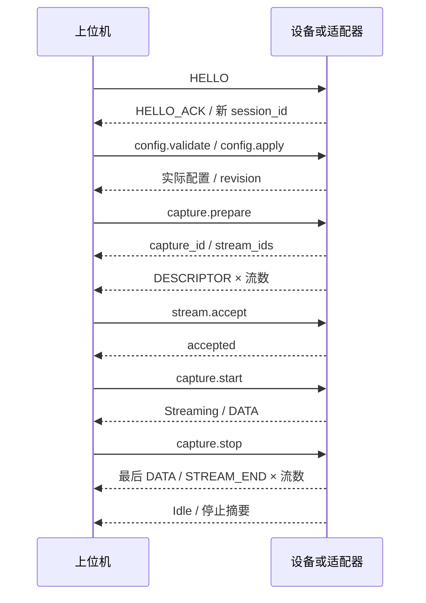

# BFSP 1.0 候选线协议规范

本文是字段与语义的唯一真值。MUST/必须表示候选版本的一致性要求；冻结前允许经兼容性评审修改，冻结后不得静默改变同一版本含义。BFSP 是本项目应用协议，不替代 USB、TCP、BLE，也不覆盖厂商原生协议。

## 1. 编码和资源约束

- 所有多字节整数为小端；浮点为 IEEE 754 binary32/binary64 小端。按字段读写，禁止直接发送带编译器 padding 的 C++ struct。
- 文本消息为 UTF-8 JSON object，无 BOM、无重复键；非有限 JSON 数字非法。JSON 深度最多 16，单字符串最多 4096 UTF-8 字节，数组最多 4096 项。
- JSON 中 u64/i64 值一律使用规范十进制字符串；零写作 `"0"`，正数不带前导零，负数以 `-` 开头且不允许 `-0`，数值必须在相应类型范围内。u32 可用 JSON number，但必须整数且在范围内。UUID 为小写带连字符字符串。时间不使用受 locale 影响的文本。
- 基础帧总长 `24 + payload_length + 4`。payload 硬上限 `1,048,576` 字节；JSON 额外上限 `65,536` 字节。HELLO/HELLO_ACK 在协商前最多 4096 字节。
- 实际上限为硬上限、接收方声明上限、承载方式上限三者的最小值，双向分别计算。发送方必须先限制块大小，接收方必须在分配前验证。
- 规则采样描述最多 4096 通道、会话最多 64 条流；客户端初版可声明更低上限（建议 256 通道/流、16 流）。描述仍必须装入单个合法 JSON 帧，不允许绕过帧上限；超限返回 capability.limit，不宣称硬上限内每种组合均可用。

## 2. 基础帧

### 2.1 帧头（固定 24 字节）

| 偏移 | 字段 | 类型/字节 | 1.0 含义 |
| --- | --- | --- | --- |
| 0 | magic | bytes[4] | `42 46 53 50`，ASCII BFSP |
| 4 | major | u8 / 1 | 固定 1；不同 major 拒绝连接 |
| 5 | message_type | u8 / 1 | 下表消息类型 |
| 6 | flags | u16 / 2 | 1.0 固定 0；不承载压缩、加密或分片 |
| 8 | header_length | u16 / 2 | 1.0 必须 24；未来扩展须协商后才可用 |
| 10 | reserved | u16 / 2 | 必须为 0 |
| 12 | payload_length | u32 / 4 | 仅消息体字节数，不含帧头与 CRC |
| 16 | stream_id | u32 / 4 | 0 为连接级控制；非零绑定当前会话中的流 |
| 20 | sequence | u32 / 4 | 每方向、每 stream_id 从 0 开始递增，模 2^32 回绕 |

sequence 在可靠控制和关联 UDP 数据之间共享同一发送计数器。它辅助诊断重复/乱序，**丢失的采样数以 sample_index 判定**，不能用序号差直接乘一个固定包长。序号比较按模运算，前向差须小于 2^31；超出可判定窗口进入重新握手流程。

### 2.2 校验尾部（4 字节）

尾部为 CRC-32C/Castagnoli，小端 u32。覆盖范围为全部 24 字节帧头及 payload，不包括 CRC 本身。参数：width=32，poly=`0x1EDC6F41`，reflected poly=`0x82F63B78`，init=`0xFFFFFFFF`，refin=true，refout=true，xorout=`0xFFFFFFFF`。标准校验输入 ASCII `123456789` 的结果必须为 `0xE3069283`。

CRC-32C 算法参考 [RFC 4960 附录 B](https://www.rfc-editor.org/rfc/rfc4960.html#appendix-B)；BFSP 明确采用上述小端存储规则，不能直接照搬其他协议字段排列。

**没有固定帧尾标志，也不对 payload 做字节转义。** payload 内允许出现 BFSP 魔数，正常解析仅按长度。串口噪声导致失步时才进入搜索状态。使用结束字节作为定界的另一类设计必须配套转义，参考 [RFC 1662](https://www.rfc-editor.org/rfc/rfc1662.html)，本版不采用该设计。

### 2.3 字节流解析状态机

`寻找 magic → 收集 24 字节头 → 检查版本/类型/长度/保留位 → 等待完整帧 → CRC → 消息 schema → 发布`。

1. 未找到 magic 时仅保留可能构成 magic 前缀的最后 3 字节；分次读取和多个帧合并读取均需支持。
2. 头字段非法或 CRC 失败：记录计数，从候选 magic 的下一字节重新扫描缓冲，不把整块输入直接清空；限制扫描工作量，不能阻塞 GUI。
3. 已到合法帧长度且 CRC 正确，但 JSON/schema 无效：丢弃这一整帧并报告 protocol.invalid_payload，不在它内部再次搜索 magic。
4. 未完成帧按承载方式的总超时丢弃候选并重新扫描。超时从该候选 magic 首字节到达开始，不因每收到一个字节无限续期。
5. 连续 8 个坏候选或连续 3 次收帧超时，使连接进入 Faulted 并关闭该 transport；成功解析一帧重置连续计数。累计诊断计数不清零。
6. 对已确认不同 major 的对端，不无限重试同步；返回可识别的版本不兼容状态并断开。

CRC 与长度解析不等于安全认证，远程部署的身份验证由传输配置处理。

## 3. 消息类型

| 值 | 名称 | 编码 | stream_id / 方向 |
| --- | --- | --- | --- |
| 0x01 | HELLO | JSON | 0，客户端 → 服务端 |
| 0x02 | HELLO_ACK | JSON | 0，服务端 → 客户端 |
| 0x03 | COMMAND | JSON | 0，客户端 → 服务端 |
| 0x04 | RESPONSE | JSON | 0，服务端 → 客户端 |
| 0x05 | DESCRIPTOR | JSON | 被描述的非零流，服务端 → 客户端 |
| 0x06 | DATA | 二进制 | 非零规则流，服务端 → 客户端 |
| 0x07 | EVENT | JSON | 关联非零流或 0，服务端 → 客户端 |
| 0x08 | STATUS | JSON | 0，服务端 → 客户端 |
| 0x09 | HEARTBEAT | JSON | 0，双向 |
| 0x0A | STREAM_END | JSON | 被结束的非零流，服务端 → 客户端 |

服务端指设备或适配器网关，客户端为上位机。进程内适配器实现同等语义，不要求生成这些字节。第一版未知消息类型拒绝，未知 JSON 可选字段可忽略，未知必需 feature 拒绝；不能忽略影响数据解码的字段。UDP 只允许 DATA，其余走关联的可靠控制通道。

## 4. 握手、能力与描述

### 4.1 HELLO

```json
{
  "protocol": {"major": 1, "minor": 0},
  "client_name": "BoundFree Community",
  "client_version": "0.2.2-beta.1",
  "receive_limits": {"max_payload": 1048576, "max_json": 65536, "max_channels": 256, "max_streams": 16},
  "features": ["regular_samples.v1", "events.v1"],
  "required_features": ["regular_samples.v1"],
  "nonce": "e66b89d8-c7ad-4982-9b68-777ea4b410a3"
}
```

HELLO_ACK 必须包含 `ok`、回显 nonce。成功包含协商 protocol、服务端 receive_limits、features、device、session_id、boot_id、heartbeat_ms、idle_timeout_ms；失败包含结构化 error，发送后关闭。

默认 heartbeat_ms=1000、idle_timeout_ms=5000；只要收到任何有效帧即可刷新对端活跃时间。HEARTBEAT payload 是 object，可包含本地单调时间字符串；空 object 合法，不能作为采样时间或命令 ACK。

本版控制连接同时持有采集租约。连接关闭或服务端超过idle_timeout未收到客户端有效帧时，服务端立即撤销会话/UDP token，并尝试停止本会话启动的采集或取消SDK订阅；有限时清理并释放资源。不能确认硬件已停止时记录状态unknown，下一连接必须先查询设备，禁止假设它处于Idle。设备若自主持续采样，明确报告subscription语义，不承诺租约能使硬件断电。阻塞SDK不得阻止租约监控线程/进程运行。

device 至少有 `device_id/name/vendor/model/firmware/identity_strength/capabilities`；unknown 值用 null。capabilities 明确 `can_configure/can_start_stop/supports_hardware_timestamps/supports_udp`、可选参数及其范围、组合限制与当前有效配置。配置合法性最终由 config.validate 决定，不能只根据几个独立 min/max 组合出设备不支持的配置。

minor 取双方支持的最高共同版本，1.0 只有 0；不能把产品版本作为兼容性依据。HELLO_ACK 成功后才允许其他消息。一次连接只握手一次；重连创建新 session_id，清空旧流表、操作表、分片和重排缓冲。

### 4.2 StreamDescriptor

DESCRIPTOR payload 必填：

| 字段 | 类型 | 约束 |
| --- | --- | --- |
| session_id / capture_id | UUID | session 必须等于握手值 |
| stream_id / descriptor_revision | u32 | 与帧头一致；revision 从 1 开始 |
| name / signal_type | string | signal_type 如 eeg/eog/emg/ecg/voltage/temperature/pressure/aux |
| rate_num / rate_den | u32 | 均 >0，Hz=分子/分母；不靠小数相等比较采样率 |
| dtype / layout | string | dtype 见 DATA；layout 固定 channel_major |
| channels | array | 1..协商上限，顺序即数据顺序，channel_id 唯一 |
| clock | object | clock_id、ticks_per_second_num/den（u64 字符串，均正）、source、epoch |
| max_samples_per_block | u32 | >0 且满足协商帧限制 |

clock.source 枚举 hardware/host_monotonic/estimated；clock.epoch 必须为 `boot_relative` 或 `session_relative`，不能直接填未声明的 Unix 时间。epoch 在 boot/session 生命周期内稳定；clock_id 在 session 内唯一标识一个时钟域，相同 clock_id 的定义必须一致。

每通道必含 `channel_id/name/signal_type/unit/scale/offset`。unit 使用注册符号 `V/mV/uV/A/mA/Pa/kPa/degC/1/count` 或 null；signal_type 与单位组合校验。scale/offset 是有限数值，scale 不得为 0。unit=null 时 scale=1、offset=0，禁止声称已物理标定。浮点物理值仍显式写 scale=1、offset=0。设备特定扩展放 `extensions`，命名 `vendor.feature`，不影响基础字段解释。

可选字段：有效 ADC 位数、量程、参考与带宽、传感器位置、来源协议、原始计数器起点、时钟精度。缺省即 unknown，不假定某硬件过滤过的频段可恢复。

描述在采集段内不可变。接收端必须先验证描述、建立预算并发送 stream.accept，服务端收到成功确认后才能接受 capture.start。某描述超出 JSON 长度或客户端能力，应拒绝整个 prepare，并通过新的配置缩减通道或另换适配策略，不能截断通道表。

### 4.3 配置与能力的公共形状

device.capabilities.config_schema 使用 schema_version=1，定义参数类型、枚举/范围、是否只读、单位和适用流。公共配置 candidate 形状如下；group_id 是设备能力中定义的采样组，不是尚未 prepare 的 stream_id：

```json
{
  "groups": [{
    "group_id": "analog-0",
    "enabled_channel_ids": ["ch1", "ch2"],
    "rate_num": 250,
    "rate_den": 1,
    "dtype": "int24"
  }],
  "device_options": {}
}
```

device_options 键为已声明的 vendor.feature，禁止任意字符串直接变成设备命令。config.validate/apply 的 params 为 `candidate` 和 u32 `expected_revision`；版本不符返回 device.config_conflict。validate 成功返回 effective_config、errors=[]、warnings=[]；警告使用 code+params，例如设备会选用另一个合法速率。apply 必须返回 readback 后的 effective_config 与 config_revision；未声明 can_configure 的设备只读当前有效配置，跳过 validate/apply，仍走 prepare/start。

device.get_status 的 state 使用 `Idle/Prepared/Starting/Streaming/Stopping/Faulted`，不是 UI 的 Connecting/OutcomeUnknown 等本地状态。结果包括 active_capture_id、config_revision、streams（stream_id、descriptor_revision、last_sample_exclusive 或 null）、last_operation（request_id、method、state、result/error 或 null）。操作 state 为 pending/completed/failed/unknown；服务端缓存过期时返回 unknown，不伪造“未执行”。

## 5. DATA 采样块

### 5.1 固定 48 字节前缀

| payload 内偏移 | 字段 | 类型 | 约束 |
| --- | --- | --- | --- |
| 0 | descriptor_revision | u32 | 必须匹配已接受描述 |
| 4 | dtype | u8 | 1=int16，2=int24，3=int32，4=float32，5=float64 |
| 5 | layout | u8 | 0=channel_major |
| 6 | time_flags | u16 | bit0=timestamp_valid，bit1=estimated；其他 0 |
| 8 | channel_count | u32 | 与描述完全相等 |
| 12 | sample_count | u32 | 每通道样本数，必须 >0 |
| 16 | first_sample_index | u64 | 该采集段的样本序号，见下文 |
| 24 | first_timestamp_ticks | u64 | 第一列样本的采样时刻；无效时 0 |
| 32 | clock_id | u32 | 与描述相同 |
| 36 | quality_flags | u32 | bit0=检测到削顶，bit1=质量可疑，bit2=之前有长度未知缺口；其他 0 |
| 40 | reserved | u64 | 必须 0 |
| 48 | samples | bytes | 连续通道优先数据，无隐式 padding |

bit1=estimated 必须同时设置 timestamp_valid；无有效时间时两个时间位均 0。硬件时钟描述不能把估算时间伪装为硬件时间。质量位表示“块内存在这种情况”，不表示每个样本都异常；需要具体位置时另发带通道、起点和长度的 EVENT。

布局：`ch0[s0..sN-1], ch1[s0..sN-1], ...`。

```text
payload_length = 48 + channel_count × sample_count × bytes_per_sample
total_frame_bytes = 76 + channel_count × sample_count × bytes_per_sample
```

全部乘加先做溢出检查。只接受精确相等长度，不允许尾部多余字节或根据 payload 猜 channel_count。float 值必须有限；遇非有限块拒绝、记录质量错误和已知样本区间缺口，不替换为零再当成有效样本。整数 24 位采用三字节二补码小端，解码至 int32 时必须正确符号扩展。

first_sample_index 相对该次 capture.start 的设备采样起点，以 u64 计数。首块通常为 0；如果已知先丢了 100 个样本，则首块为 100 并记录 [0,100) 缺口。设备不提供计数器时，适配器只能为收到的样本生成序号，并声明 `sample_index_source=adapter_received`（描述可选字段，默认 device）；其缺口长度无法精确得知时使用 unknown 事件与质量位，不能声称所有设备丢样均可检测。

块内第 j 列的采样时刻为 `first_timestamp + j × rate_den / rate_num` 秒；ticks 到秒用 clock 的有理数频率换算，保留分数精度，不逐样本截断到整数 tick。采样不能视为等间隔的来源不允许冒充本版 DATA，须另定义逐样本时间 feature。跨块硬件时间与名义速率的小偏差交给时钟质量模型，不能擅自增删样本纠正漂移。

同一 stream 计数不回绕，超过 u64 范围必须结束流。原生设备窄计数器由适配器在可判定范围内展开；无法区分重启、回绕或长时间丢包时终止该流，不能凭猜测继续。

## 6. 命令、响应与生命周期

COMMAND：`{"request_id":"UUID","method":"capture.start","params":{"capture_id":"UUID"}}`。

RESPONSE 成功：`{"request_id":"UUID","ok":true,"result":{...}}`；失败：`{"request_id":"UUID","ok":false,"error":{"code":"device.busy","params":{},"retryable":false}}`。两者互斥，request_id 原样返回。只有合法完整响应才完成本地操作。

| 方法 | 参数与结果 | 可执行状态 |
| --- | --- | --- |
| device.get_info | 返回身份、能力、配置 schema | 握手后 |
| device.get_status | 返回 state、active_capture_id、config_revision、每流最近样本位置、最近操作结果 | 握手后；超时恢复必备 |
| config.validate | candidate、expected_revision；返回 errors、warnings、effective_config，不写设备 | Idle |
| config.apply | 同上；成功返回 readback 后实际配置与新 revision | Idle 且无有效 prepared capture |
| capture.prepare | expected_config_revision；返回 capture_id、stream_ids，随后逐流 DESCRIPTOR | Idle；不开始采样 |
| stream.accept | capture_id、非空 streams 数组（每项 stream_id、descriptor_revision）；返回 accepted=true | Prepared；完整列表全有全无 |
| capture.start | capture_id；返回 state=Streaming、capture_id | Prepared 且全部描述已接受 |
| capture.stop | capture_id；返回 state=Idle 与各流终止摘要 | Streaming/Starting/Stopping；相同 capture 已结束时可返回其摘要 |
| capture.discard | capture_id；丢弃尚未启动的准备段 | Prepared |
| time.sync | clock_id、client_send_ns 字符串；回显并返回 receive_ticks/send_ticks | 握手后，能力支持时 |
| transport.bind_udp | params 包含接收地址 `address` 和端口 `port`；返回发送端点、128位token、报文上限；详见承载规范 | Idle，双方声明supports_udp |
| device.disconnect | 无；确认后关闭连接 | Idle；Streaming 时返回 device.busy |

`stream.accept` 的 `params` 示例：

```json
{"capture_id":"22222222-2222-4222-8222-222222222222","streams":[{"stream_id":1,"descriptor_revision":2},{"stream_id":2,"descriptor_revision":1}]}
```

`streams` 为 1–64 项，两个字段均为正 u32，`stream_id` 不得重复，即使 revision 不同也必须拒绝。服务端逐项核对该 capture 的所有已准备流及其描述版本；缺项、多项或版本不符时拒绝整个请求，不能部分接受。只有完成列表及会话核对后，才能返回 `accepted=true`。

`transport.bind_udp` 的 `params` 为 `{"address":"127.0.0.1","port":45120}`；`address` 为非空字符串，`port` 为 1–65535 的整数。具体地址可用性、对端授权及会话绑定由承载层核对。`device.get_info`、`device.get_status` 与 `device.disconnect` 的 `params` 没有必填字段；空对象合法，也允许可选扩展字段。

没有 start/stop 能力的被动 SDK，由适配器实现“订阅/停止订阅”语义并在能力中声明 `acquisition_control=subscription`；UI 显示“开始接收/停止接收”，不能声称已停止硬件采样。

服务端必须串行维护：Idle→Prepared（prepare）→Starting（start）→Streaming→Stopping（stop）→Idle。prepare 失败回 Idle，start 失败且已确认未开始则回 Prepared；无法确认时进入 Faulted，禁止新 start。capture.discard 使 Prepared→Idle；准备失败或接受描述失败时客户端必须 discard，连接断开自动释放 prepared 资源。Prepared 状态的普通 disconnect 返回 device.busy，客户端先 discard。客户端收到数据但 start 响应声称失败时视为状态冲突，立即核实/停止，不直接丢弃事实继续显示 Idle。

配置使用事务语义：先验证→执行→回读。部分写入失败时返回 `device.config_partial`，附 effective_config 或 unknown；必须重新读取核实后才能开始。设备端持久化配置不属于普通 apply，首版不提供隐式写 Flash。

每连接最多一个变更操作在途；状态查询、心跳可继续，stop 可抢占尚未完成的 start，但服务端必须串行处理状态转换。请求去重窗口为 120 秒且最多最近 256 个完成的变更请求（先到者淘汰）；窗口内相同 ID/相同内容返回原结果，不执行第二次，不同内容返回 request.conflict。客户端不依赖窗口外的去重，不重放旧 session 命令。

普通查询超时 3 秒；apply/prepare/start/stop 默认 10 秒，可由能力声明有限上限，最大 30 秒。变更命令超时后进入 OutcomeUnknown，先 get_status，**禁止自动重发 start/apply**；查询也失败则 Faulted。先核实 active_capture_id 与目标状态，再允许用户的新操作。



启动后首块 DATA 可能先于 start 响应到达，客户端在 Starting 状态有界接收已接受描述的块，并按对应 capture_id 隔离；不得因响应稍晚丢掉首块。第一块有效数据到达才显示“正在采集”；只收到启动成功响应而超出 first_data_timeout（默认 5 秒，低采样率按至少两个预期块周期放宽、最多 30 秒）仍无数据，显示“已启动但未收到数据”，核实状态。

STREAM_END payload：capture_id、stream_id、`last_sample_exclusive`（u64 字符串或 null）、reason、complete。normal stop 的每流终止摘要与 stop 响应相同；未采到样本且位置确知时 end=0。UDP 尾包等到重排期限结束再清算；意外断开可无 END，此时端点未知，不伪造完整结束。

complete 只表示发送端正常封闭了该流及其已知终点，不保证接收端没有丢包；录制的完整性结论还必须合并接收缺口、设备报告损失、写盘结果与未知边界。

stop 响应意味着停止出新采样且已发送 END，不意味着客户端录制队列已写盘完成。录制 finalize 由客户端单独完成。

## 7. 事件、状态与时间

EVENT 必含 UUID `event_id`、`kind`、`params`；关联流事件须与 header `stream_id` 一致，并带 `descriptor_revision`，可选 `sample_index/count`（u64 字符串）、`channel_ids`、`clock_id/ticks`。kind 包含 `trigger.edge/data.gap/data.quality/device.warning/clock.discontinuity`。

`data.gap` 必须关联非零 `stream_id` 及对应的 `descriptor_revision`；顶层必须同时提供 `sample_index` 和 `count`，每项为 u64 字符串或 null（未知）。`params` 必含非空字符串 `reason` 和 `detection`；旧的 `params.start`、`params.count` 不是本版字段，必须拒绝以免产生歧义。已知 `count` 必须大于 0；当起点与数量均已知时，区间为半开 `[sample_index, sample_index + count)`，且加法结果不得超过 u64 最大值。例如：

```json
{"event_id":"11111111-1111-4111-8111-111111111111","kind":"data.gap","stream_id":1,"descriptor_revision":2,"sample_index":"100","count":"4","params":{"reason":"lost_data","detection":"sample_counter"}}
```

STATUS 必含 state、active_capture_id（无为 null）、config_revision、counters；计数器 u64 字符串，区分设备报告丢样、接收丢样、CRC 错误、显示跳过、录制丢失，禁止汇成一个含糊的“丢包率”。STATUS 不完成请求，只更新观察状态。

time.sync 的四时刻为客户端发送 t0、服务端接收 t1、服务端发送 t2、客户端接收 t3。t0/t3 取同一主机单调时钟，t1/t2 为同一 clock_id 的 ticks；换算为秒后估计 RTT 与偏移，采用低 RTT 样本及分段线性拟合估计漂移。保留全部原始测量及映射版本；发生负 RTT、clock reset 或明显离群即拒绝该测量。

网关只能提供其实际可测的时钟，无法获取设备采样时钟时，time.sync 只同步网关主机，并声明 estimated。建议每 5 秒采样一次时钟测量，初始与重连加密采样；精度必须报告 unknown 或经实测的误差范围。触发同步和 PTP 等硬件机制列为未来能力，不因协议有 ticks 就宣称支持。

## 8. 错误、版本与扩展

候选注册表（实现时同步 `contracts/error_codes.json` 与四语）：

| code | 意义与恢复 |
| --- | --- |
| protocol.version_mismatch | 版本不兼容，停止握手 |
| protocol.invalid_frame / invalid_payload | 帧或消息非法；按解析规则恢复或断开 |
| protocol.limit_exceeded | 长度/通道/流/JSON 预算超限，拒绝该配置 |
| capability.unsupported / capability.limit | 能力不存在或组合不支持，提供可选配置 |
| device.busy / device.invalid_state | 不允许当前操作，查询状态 |
| device.config_partial | 配置部分生效，读取实际状态后再操作 |
| device.permission_denied / device.disconnected | 权限或连接故障，展示对应恢复入口 |
| request.timeout / request.conflict | 结果未知需查询，或请求 ID 内容冲突 |
| acquisition.no_data / acquisition.data_gap | 没有数据或数据不连续 |
| acquisition.clock_discontinuity | 时钟不连续，结束旧采集段 |
| capture.backlog_overflow / capture.disk_full | 录制失败，清算可保存部分，禁止提示成功 |

表中共享前缀的缩写写法只用于阅读，例如 invalid_payload 的完整码是 protocol.invalid_payload。协议错误码与现有仓库同名码在实施时核对参数，不直接改变已有含义；确有冲突则使用 bfsp.* 命名空间并写迁移表。

未来新增 dtype、压缩、扩展头、无规则逐样本时间和远程多控制端必须通过新 feature 与 minor/major 规则设计。1.0 不允许发送者私下占用保留字段；未知单位也不得用现有单位冒充。服务端一次只允许一个采集控制者，其他客户端返回 device.busy；多观察者网关后续另行定义。

## 9. 一致性示例与实现交接

[协议向量](../contracts/bfsp/frame-vectors.json) 包含 HELLO、描述、int24 与 float32 DATA、STREAM_END、CRC 和损坏样例。C++ 协议测试独立解码并逐字节比对这些向量；Python 契约测试检查注册表与 JSON Schema。在仓库根目录运行，`<build-dir>` 为已配置的原生构建目录：

```bash
cmake --build <build-dir> --target bfsp_protocol_test
<build-dir>/bfsp_protocol_test "$PWD"
python3 -m pytest -q tests/contracts/test_bfsp_contracts.py
```

这些检查覆盖编码和部分错误恢复；设备状态机、其他传输方式、线程和硬件仍须分别验收。

实施冻结条件：两个独立实现（建议 C++ 与 Python）对字节向量完全一致，按协议测试矩阵通过；没有真实硬件的阶段只能称为候选 BFSP，实现者不得从可运行样例推定所有传输路径已经验收。
