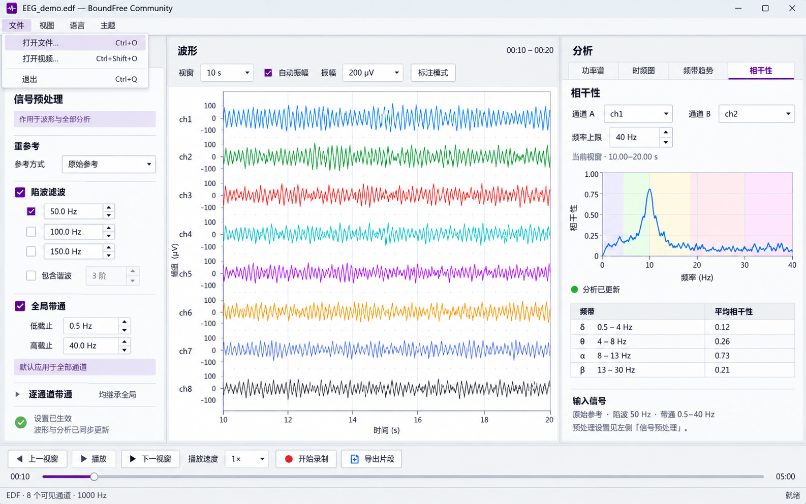

# EEG 三栏工作区与信号预处理分组

## 行为与范围

按已确认布局，将全局信号设置与当前分析的局部参数分开，避免把分析图下的“处理”理解成相干性专属设置。

## 确认后的布局示例



- 左侧为通道、信号预处理、事件标注三个标签页；打开新文件后默认显示信号预处理。
- 重参考、陷波总开关、陷波频率、谐波及全局带通集中在左侧；作用范围标明“波形与全部分析”。逐通道带通和批量覆盖操作默认折叠；修改仍自动更新波形与分析。
- 中间为波形、视窗、自动/手动振幅和标注模式；首个通道导航移到左侧通道页。视频仍在波形下方。
- 右侧只保留四类分析及其参数、结果，增加只读输入信号摘要；相干性的通道 A/B、频率上限有明确标签。标签在输入框上方，允许窄栏换行。隐藏分析时同时回收右栏空间。
- 文件操作使用“文件”菜单与原有 Ctrl+O/Ctrl+Shift+O/Ctrl+Q；工作区不增加文件工具栏。当前文件名进入窗口标题，状态栏显示格式、可见通道数和采样率。保留未打开文件时的欢迎页入口。
- 底部共用播放、定位、录制和片段导出；顺序为上一视窗、播放、下一视窗。

产品版本通过 `version_sync.py` 同步为 `0.1.83-dev`。新增文案覆盖简中、繁中、英文、日文，以及保留语言和伪本地化资源。计算、IPC 与文件格式协议沿用既有实现。

## 验证

构建命令：

```bash
cd native
cmake --preset wsl2-qt6-conda
cmake --build --preset wsl2-qt6-conda -j 6
```

已完成 CMake 构建、i18n、版本同步、JSON 和差异空白检查；发布资产静态检查 10 项通过。原生处理状态测试与 `--smoke-m8-system-ui` 通过。界面机械扫描无输出项；扫描对原生 Qt 的覆盖有限。

最终联合回归 **78 passed in 54.23s**；包含布局、原生样式与缩放、空白页、逐通道参数、四类分析、完整文字、波形、连续回放、真实读片、拖动定位、视频同步、录制和导出。

联合回归命令（仓库根目录，Bash）：

```bash
QT_QPA_PLATFORM=offscreen BF_LAYOUT_SCREENSHOT_DIR=../build/eeg-three-column \
python3 -m pytest tests/native/test_{fixed_layout,reference_labels,empty_controls,channel_parameters,bf_app,analysis_presentation,analysis_refresh,analysis_text,waveform_channels,waveform_viewport,continuous_playback,continuous_file,seek_preview_smoke,scrub_preview,m4_analysis_smoke,m5_playback_smoke,m6_video_sync,m7_record_export_smoke,record_form}.py -q
```

布局回归检查三栏顺序、陷波总开关与频率同组、全局设置与分析参数分离、标题文件名、文件菜单快捷键、设置与输入摘要同步、分栏拖动、逐通道编辑可达性，以及隐藏分析时回收空间。分析文字回归覆盖四类分析、五种语言、两种尺寸，要求摘要完整、维持正常字号、下拉文本及输入摘要不裁切。

联合回归发现窄栏英文摘要被裁切，已在 `AnalysisProperties` 中根据当前页所需高度，明确保留内部堆栈和标签栏高度，并在切页/切换语言时释放旧最小高度；日文相干性参数也改为纵向标签，避免挤压通道名。

运行截图保存在工作区 `build/eeg-three-column/`，包括 `workspace-coherence.png`、`file-menu.png`、四语大小窗口及 `dark/` 下的对应深色截图。本文嵌入的确认布局示例保存在仓库 `docs/images/eeg-three-column-workspace-proposal.png`。

## 验证边界

当前验证来自 WSL2/Linux 与 Qt offscreen。窄窗口优先保证分析摘要完整，必要时提高最小窗口高度；左侧设置可以纵向滚动。Windows 实机窗口、高 DPI 和媒体后端仍需桌面验收；本次未重新生成 Windows 安装包，不视为发布验收。
